
A few things to sort out before you begin. To get this account creation process to work smoothly, you'll need three things in place.

First, you'll need your smartphone for at least part of this process, since you'll be using it to snap photos of your ID and a selfie for identity verification.

Second, you'll need your own personal email address. Don't use an email that belongs to someone else, like a spouse or another family member. If you don't already have an email address, go ahead and set one up before you get started.

Third, we recommend double-checking that the name on your ID matches the name on file with your Social Security card. If you can't locate your card, an old Social Security retirement benefit statement will also show how your name is listed with SSA. If the names don't line up, it could create problems when verifying your identity. Later in this video, we'll cover what to do if that happens.

All right, let's head over to the ssa.gov website. To set up a new online account, click the sign-in button in the top right corner. You'll see two options for creating an account: login.gov and ID.me.

## Step 1: Open SSA.gov and choose Sign in

![Social Security website interface with navigation bar including Benefits, Medicare, Card & record, a search bar, language option Español, and Sign in button. Main section titled 'Securing your today and tomorrow' with three columns: Prepare (check eligibility, get benefits estimate, plan for retirement), Apply (apply for benefits, sign up for Medicare, return to saved application), After you apply (check application status, appeal decisions). Below, a section titled 'Manage benefits & information' with subsections Documents and Number & card and related links.](../../assets/images/guides/guide-creating-a-social-security-account-step-01.webp)

<em>ssa.gov website</em>

## Step 2: Choose your sign-in provider

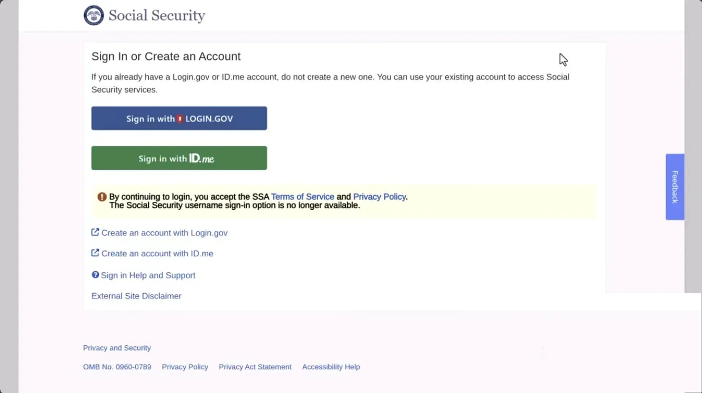

For U.S. citizens living in the U.S., either option will work, but we tend to see more people choose login.gov, especially since many already have a login.gov account from setting up TSA PreCheck at some point. This video walks through the login.gov process specifically, though you're welcome to switch over to ID.me if login.gov isn't cooperating. That said, for U.S. citizens living abroad, ID.me tends to offer more flexibility when it comes to entering international addresses and phone numbers during setup.

Once you click "Sign in with login.gov," you'll land on a page where you can either sign in to an existing account or create a new one. We'll go ahead and select the "Create an account" tab. Keep in mind that if you already have a login.gov account, you can skip a few of the early steps shown here.

## Step 3: Select Create an account on Login.gov

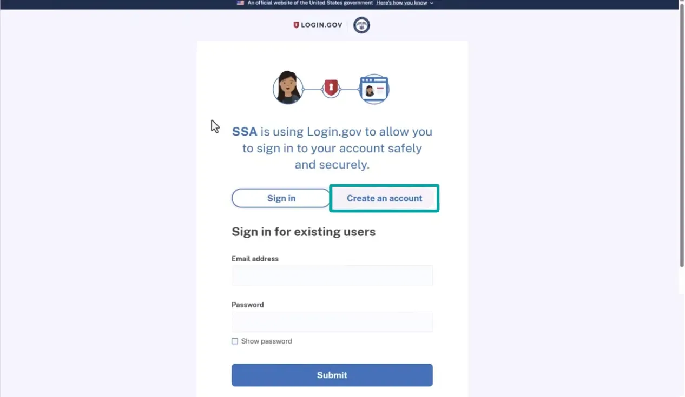

To move ahead, type in your email address, making sure it's genuinely yours, not a shared inbox or one already tied to a spouse or family member's account. The system checks for this and won't let you proceed with an email address that's already in use elsewhere. Next, check the box agreeing to the terms, then hit submit. You'll then see a confirmation that an email has been sent your way, so go check your inbox.

## Step 4: Enter your personal email address

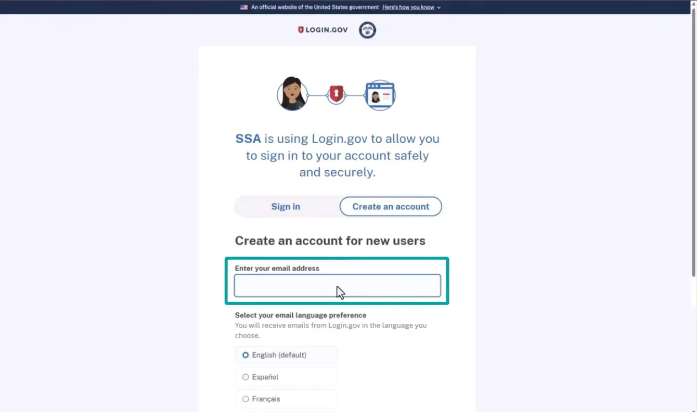

## Step 5: Review the Rules of Use and submit

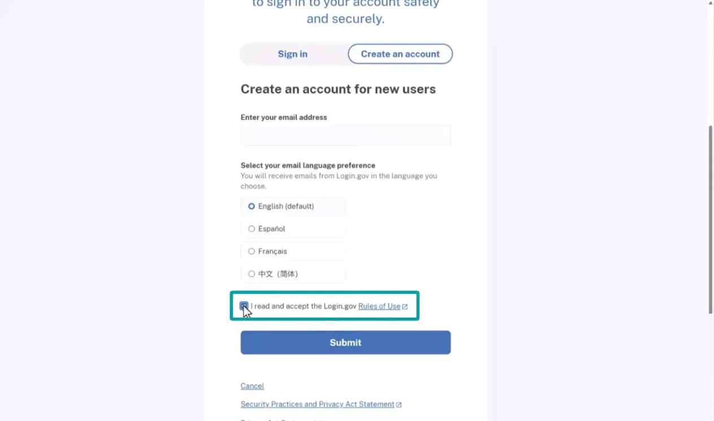

## Step 6: Check your email for the confirmation link

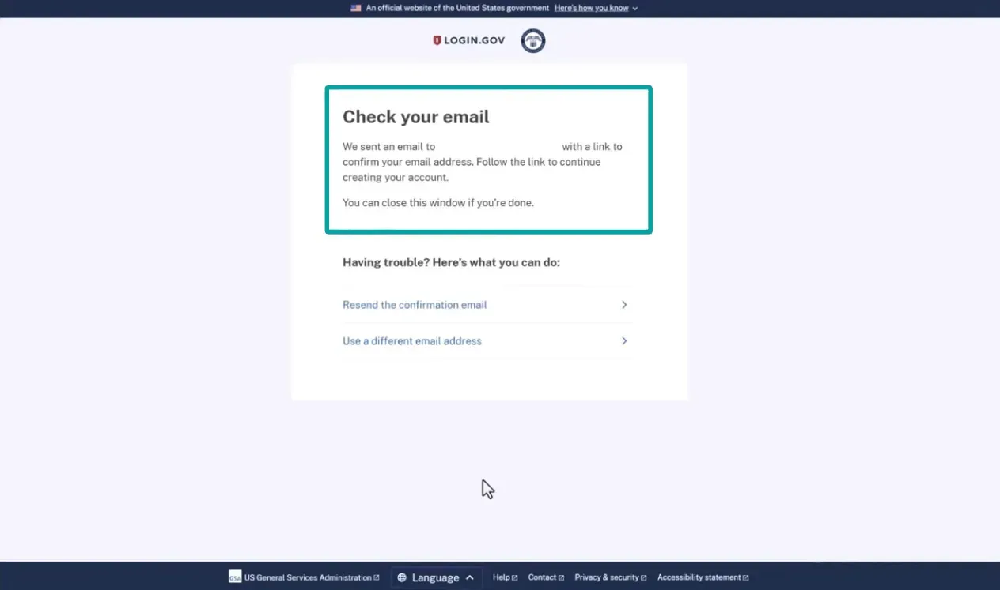

Within a minute or so, an email from login.gov should show up asking you to confirm your address. Inside, you'll find a large blue button labeled "Confirm email address." Click it, and you'll be taken to a page where you'll create a strong password for your login.gov account. After typing your password twice to confirm it matches, take a second to jot it down somewhere safe, or let your browser save it for you automatically. Either way, hang on to this password. Also worth noting: your username will be the same email address you used earlier. Once that's done, click continue.

## Step 7: Confirm your email and create a password

## Step 8: Confirm your password and continue

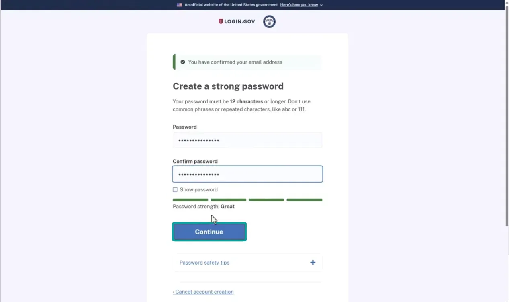

Next up is the authentication method setup. Two-step verification adds an important layer of security to your account, so SSA requires you to pick one of the listed methods. For this walkthrough, we'll go with the text message option since it's simple, but feel free to choose whichever method suits you best. After selecting "Text or voice message," scroll down a little and click continue at the bottom.

## Step 9: Review authentication methods

## Step 10: Select your authentication method

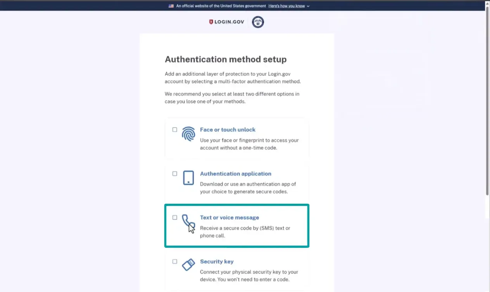

You'll then be asked to provide your mobile phone number, which is where you'll receive your two-step verification codes every time you log in going forward. Click "Send code" to trigger that first code. Check your phone, it usually shows up within seconds, though it can occasionally take a minute. Once the code arrives, type it into the "one-time code" field and click submit.

## Step 11: Enter your phone number and request a code

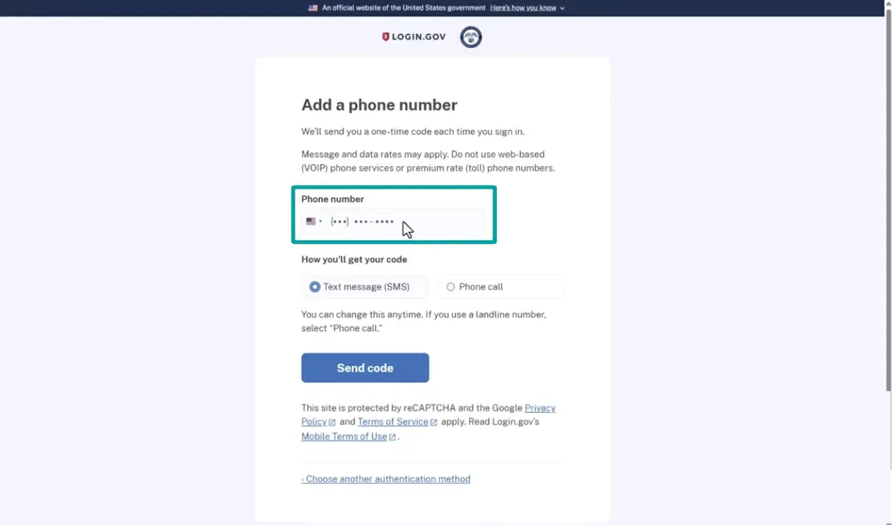

## Step 12: Enter the one-time code

The system will then offer to set up an additional layer of sign-in security. You're welcome to add it, but for this video we'll skip that step and click "Skip" at the bottom to keep things moving. On the next page, click "Agree and continue," which grants permission to link your login.gov account with the Social Security Administration.

## Step 13: Review the additional sign-in security option

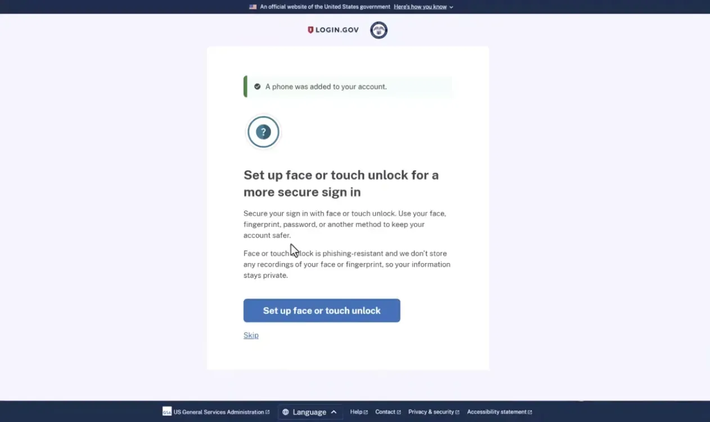

## Step 14: Set up face or touch unlock or choose Skip

Now for the more involved part. SSA has had to deal with a lot of fraud over the years, so this stage is all about proving you're really you. Grab your driver's license or state ID, since you'll use your phone to photograph the front, the back, and a selfie of yourself. You'll also need to enter your Social Security number, your personal phone number, and re-enter the login.gov password you just created. Click continue.

## Step 15: Agree to continue to SSA

The following page explains that the details you provide will be cross-checked against public records SSA has on file. Because of this, it's best to use your own phone number rather than a spouse's, since it needs to match your records. Check the box agreeing to the terms and click continue.

## Step 16: Prepare to verify your identity

Here you'll see two ways to verify your identity. We'll choose the first, using your smartphone to photograph your license and yourself. If that route isn't available or doesn't work for you, the second option lets you verify in person at a nearby post office instead. For our purposes, we'll enter our phone number and click "Send link" to receive another text from SSA.

## Step 17: Review and consent to identity verification

![Login.gov page showing the steps to verify identity: Getting started, Verify your ID, Verify your information, Verify your phone number, Re-enter your password. The page explains how verifying your identity works with sections on verifying identity by providing ID, phone number, and other information, and securing account through password encryption. A checkbox is checked to allow Login.gov to use personal information for verification. Below is a link to learn about privacy and security measures, and a blue Continue button with a cursor hovering over it. A Cancel link is at the bottom.](../../assets/images/guides/guide-creating-a-social-security-account-step-17.webp)

## Step 18: Send the verification link to your phone

## Step 19: Review the phone and in-person verification options

## Step 20: Keep your browser window open

Important: at this point, you'll shift over to your phone, but you'll need to return to this browser tab afterward, so don't close it. Once your ID is verified on your phone, this page will automatically refresh with the next steps.

Here's what that text message looks like. Tap the link inside it, and you'll be guided through capturing three images. Place your ID on a dark, flat surface, use good lighting, and try to avoid glare and shadows. Don't worry if it takes a couple of attempts to get it right; most people need a try or two.

## Step 21: Open the verification link on your phone

First up is the front of your license. Tap "Take photo," and the app will prompt you to move your camera closer or farther until it captures a usable image. Next is the back of your license, tap "Take photo" again. This one can be a little finicky, but it should eventually confirm successfully. Afterward, you'll see both images with the option to retake either one. If they look good, tap continue to move on to the final photo.

## Step 22: Photograph the front of your ID

## Step 23: Photograph the back of your ID and review both images

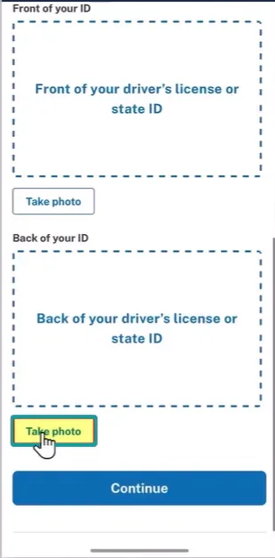

That last image is essentially a selfie. Try to match the expression from your license photo as closely as you can, and remove anything covering your face, like glasses or a hat. Tap "Take photo," line your face up inside the green circle, keep a neutral expression, and tap the green checkmark. You'll get another chance to retake it if needed. Once you're satisfied, tap submit.

## Step 24: Prepare to take your face photo

## Step 25: Take your face photo

## Step 26: Review and submit your face photo

SSA will then process your photos, which can take up to a minute. Assuming everything checks out, you'll see a message confirming, "We verified your identity document," along with instructions to switch back to your browser to wrap up account setup. Note: if verification doesn't succeed, you may need to retake the photos, try the in-person post office option, or restart the process entirely, possibly switching to ID.me.

## Step 27: Wait while your images are processed

## Step 28: Return to your computer after ID verification

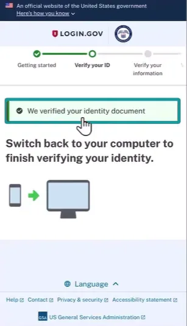

Back on your browser, the page will have refreshed with the remaining steps. Enter your Social Security number here, and we'd suggest checking the "show Social Security number" box to confirm you typed it correctly before clicking continue. The next screen recaps your contact information from the verification process, so double-check it for accuracy, then click submit.

## Step 29: Enter your Social Security number

## Step 30: Review and submit your identity information

You'll receive one more verification code by text. Enter that code once it arrives and click submit. Finally, re-enter your login.gov password and click continue.

## Step 31: Enter the phone verification code

You'll now be given a personal key unique to you, print it, write it down, or snap a photo, whatever works best. Keep this somewhere safe, since you'll need it later if you ever want to change your account password. Skipping this step means you'll have to verify your identity all over again down the road. Check the box confirming you've saved your personal key, then click continue.

## Step 32: Re-enter your Login.gov password

## Step 33: Save your personal key securely

![Login.gov account creation screen showing progress steps with four steps completed and the fifth step Re-enter your password pending. A message indicates verified information is secured. The screen instructs to save a personal key displayed as '1A2B - 3C4D - 5E6F - 7G8H' inside a shield icon. Options below include Copy, Download (text file), and Print. A warning states the personal key is needed to reset a forgotten password and should be kept safe and private, with a link to learn more about the key.](../../assets/images/guides/guide-creating-a-social-security-account-step-33.webp)

## Step 34: Confirm that you saved your personal key

This last step links your verified information to SSA. Click "Agree and continue."

## Step 35: Connect your verified information to SSA

Even after making it this far, you might occasionally run into a message saying your identity couldn't be verified. This usually means the name SSA has on file doesn't match your ID, or your date of birth is off in their system somewhere. If this happens, reach out to Social Security directly to sort out the discrepancy, you may need to provide documentation such as your Social Security card or birth certificate.

If everything checks out, though, you'll land on a preferences page inside your account. Take a moment here to choose how you'd like to receive notices from Social Security, electronically only, or both by mail and electronically. Once you've made your choice, click "Save and continue," and you'll see a confirmation that your preferences were updated. Click "Continue to homepage," and you're officially set up with your SSA account.

## Step 36: Choose your notice preferences

## Step 37: Confirm your preferences and continue to the homepage

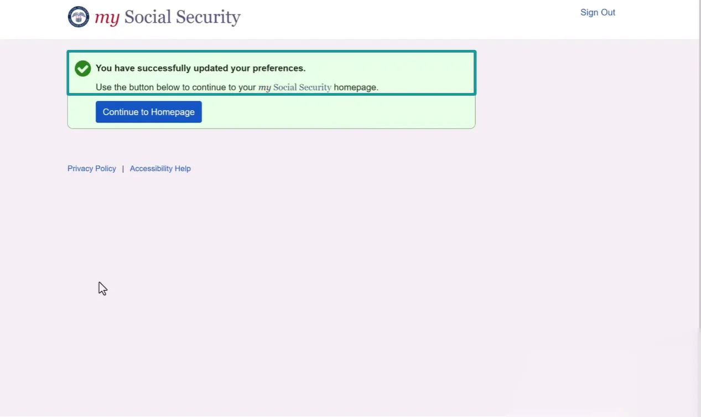

## Step 38: Review your new Social Security account

If you'd like to learn more about navigating the features inside your new SSA account,

