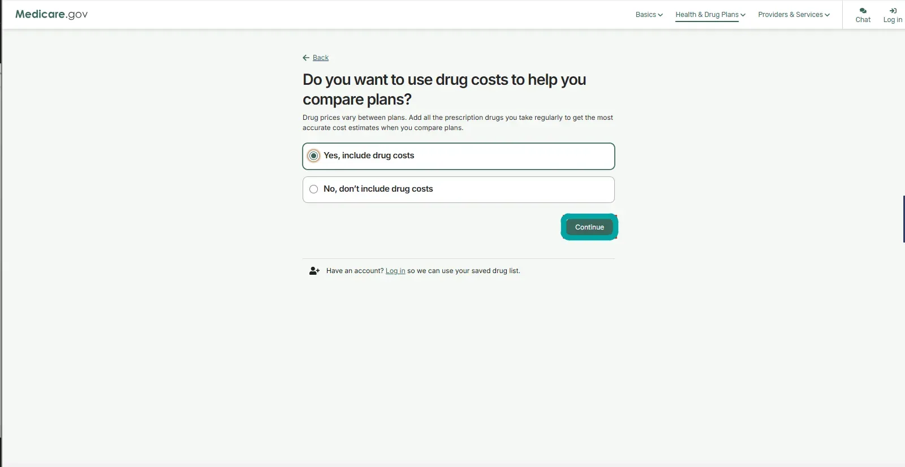
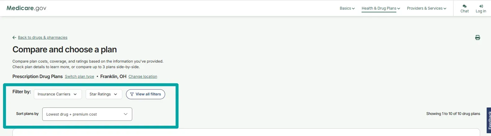
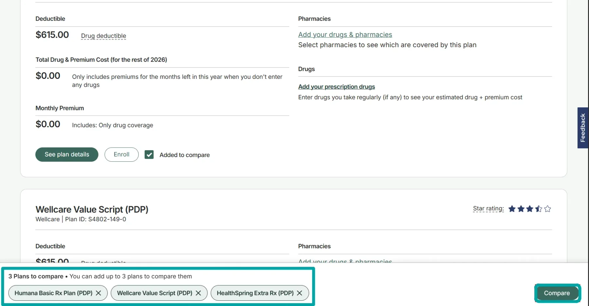
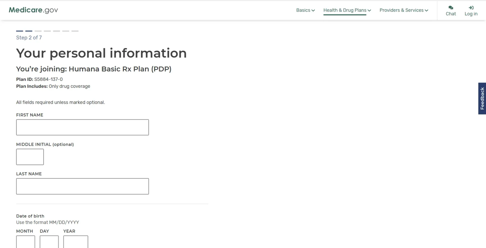

## Step 1: Open Medicare.gov

## Step 2: Choose Find health & drug plans

## Step 3: Enter your ZIP code

## Step 4: Select Drug plan (Part D)

![Medicare.gov webpage showing the heading 'Find the plan that works for you' with instructions to enter ZIP code and choose plan type. The page features a photo of three older women standing together. A section below allows users to log in or create an account to save time or select a plan type if they don't have a Medicare account. Options include Medicare Advantage Plan (Part C), Drug plan (Part D) which is selected, and Medigap policy (supplement insurance). Buttons for 'Back' and 'Find plans' are visible.](../../assets/images/guides/guide-enrolling-in-part-d-step-04.webp)

## Step 5: Indicate whether you receive help with costs

![Medicare.gov webpage asking if the user gets help with Medicare health or drug costs, listing options with radio buttons: Medicaid with explanation about Dual Eligible Special Needs Plans, Supplemental Security Income, Medicare Savings Program, Extra Help with drug costs, and a selected option stating 'I don't get help from any of these programs.' A Continue button is below. Navigation links are at the top, including Basics, Health & Drug Plans, Providers & Services, along with chat and login icons.](../../assets/images/guides/guide-enrolling-in-part-d-step-05.webp)

## Step 6: Choose whether to include drug costs

## Step 7: Add your prescription drugs

## Step 8: Review and sort available drug plans

## Step 9: Review a plan and add it to your comparison

## Step 10: Open your selected plan comparison

## Step 11: Compare monthly premiums and plan ratings

## Step 12: Review drug coverage and costs

## Step 13: Check deductibles and prescription cost estimates

## Step 14: Add drugs for more accurate estimates

## Step 15: Find and select your pharmacies

## Step 16: Review what you need and choose Join Plan

## Step 17: Review enrollment period requirements

![Medicare.gov enrollment page for Humana Basic Rx Plan (PDP) showing instructions to start application, plan details including Plan ID S5884-137-0 and drug coverage only. It explains enrollment periods for joining Medicare Advantage or Drug Plan Part D, with a note on Cost Plans. The user is asked to confirm enrollment period eligibility by checking applicable statements. A highlighted note warns that joining a Medicare drug plan after the Initial Enrollment Period may incur a Part D late enrollment penalty unless the user gets Extra Help with drug costs, linking to more information.](../../assets/images/guides/guide-enrolling-in-part-d-step-17.webp)

## Step 18: Check the new-to-Medicare enrollment options

![Form section titled 'Initial Enrollment Period & other new to Medicare situations' with a highlighted note stating that joining a Medicare drug plan after the initial enrollment period may include a Part D late enrollment penalty, but with Extra Help, no penalty applies. Checkboxes follow for statements: I'm new to Medicare; I'm new to Medicare and was notified after my Part A and/or Part B coverage started; I had Medicare before but am now turning 65. Next section is 'Medicare Advantage Plan Open Enrollment Period' with a checkbox for having Medicare less than 3 months and wanting to make a change. The start of a 'Special Enrollment Period' section is visible.](../../assets/images/guides/guide-enrolling-in-part-d-step-18.webp)

## Step 19: Review Special Enrollment Period options

## Step 20: Select the enrollment situation that applies to you

## Step 21: Enter your Medicare information

## Step 22: Read and acknowledge the Privacy Act Statement

## Step 23: Enter your personal information

## Step 24: Enter your address

## Step 25: Answer the general coverage questions

## Step 26: Choose how to pay your plan premium

## Step 27: Review and accept the plan agreement

## Step 28: Review your application and correct any errors

## Step 29: Acknowledge and submit your application

