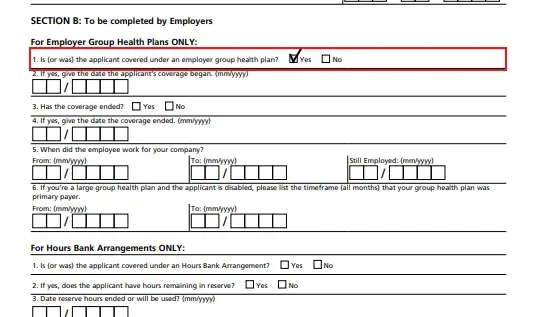
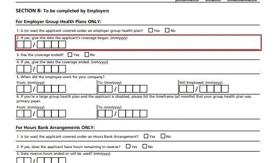

## Intro

If you're signing up for Medicare Part B after age 65 and you're leaving a group health plan tied to your own current job or your spouse's current job, you'll need to know how to correctly complete Form CMS-L564. In the next few minutes, we'll walk through the form step by step so you can submit it without errors.

## Step 1: Review the Form L564 instructions

## Special Enrollment Period basics

A quick refresher: your Special Enrollment Period applies when you're past your seven-month Initial Enrollment Period for Medicare and you're leaving a group health plan through an employer — either your own or your spouse's. To avoid a Part B late enrollment penalty, you must submit your application either while you're still covered under that employment-based group plan, or within eight months after your coverage or employment ends.

In this situation, you'll need to submit two forms to your local Social Security office: Form CMS-40B and Form CMS-L564. Both are available for download at ssa.gov/forms.

## Form L564 overview

Form L564, the Request for Employment Information, is divided into two parts — Section A and Section B. Most of the delays we see happen at a handful of predictable spots, so let's go through the form carefully and get each one right.

One thing to know up front: Social Security requires a separate form for every person enrolling in Part B. So if a married couple is applying at the same time, each spouse needs their own completed L564 — even the spouse who isn't working. That's because the non-working spouse's coverage comes through the working spouse's job, and Social Security still needs to verify the coverage dates for both people individually.

## Step 2: Identify Section A for the applicant

<em>Section A</em>

## Step 3: Identify Section B for the employer

<em>Section B</em>

## Section A: completed by the applicant

Section A is meant to be filled out by the person enrolling in Medicare Part B. In practice, employers often complete this section for the applicant — but you're free to fill it in yourself, either before handing the form to your employer or after you get it back.

## Step 4: Begin the applicant section

![Form titled 'Request for Employment Information' from the Department of Health and Human Services and Centers for Medicare & Medicaid Services, used to collect details for Medicare Part B enrollment. Section A, outlined in red, is to be completed by the individual and includes fields for Employer's Name, Date, Employer's Address, City, State, Zip Code, Applicant's Name, Applicant's Social Security Number, Employee's Name, and Employee's Social Security Number. Section B, partially visible below, is for employers to complete for group health plans, including questions about coverage status and dates.](../../assets/images/guides/guide-filling-out-the-l564-form-step-04.webp)

Field 1 is your employer's name.

## Step 5: Enter the employer's name in Field 1

Field 2 is the date you're completing Section A.

## Step 6: Enter the completion date in Field 2

Field 3 is the employer's address.

## Step 7: Enter the employer's address in Field 3

Fields 4 through 7 are where most of the confusion happens.

## Step 8: Identify the applicant and employee fields

Field 4 is the applicant's name — the person enrolling in Medicare.

## Step 9: Enter the applicant's name in Field 4

Field 5 is the applicant's Social Security number.

## Step 10: Enter the applicant's Social Security number in Field 5

Field 6 is the employee's name, which may or may not be the same person named in Field 4.

## Step 11: Enter the employee's name in Field 6

## Step 12: Enter the employee's Social Security number in Field 7

If you're both the Medicare applicant and the employee whose job the coverage is based on, Fields 6 and 7 should simply repeat what you entered in Fields 4 and 5.

But if the applicant is a spouse who's a dependent on someone else's group plan, the applicant and the employee are two different people — meaning the names and Social Security numbers in Fields 4/5 and 6/7 won't match.

## Step 13: Check the applicant and employee details for spousal coverage

That's the whole of Section A. The one thing to double- and triple-check is that the applicant's identity and the employee's identity are entered correctly and in the right fields.

## Section B: completed by the employer

Section B must be completed by the employer — this part isn't optional for them to skip.

## Step 14: Have the employer complete Section B

Field 1 needs to be marked "Yes." If it isn't, Social Security can't process the form.

## Step 15: Confirm employer group health coverage in Field 1

Field 2 trips people up more than any other line on the form. It asks for the date the applicant's coverage began — but the wording is easy to misread. What it's actually asking for is the month and year the applicant's group health coverage originally started with this employer, not the date of the most recent plan renewal.

## Step 16: Enter the original coverage start date in Field 2

This is the most common employer error: entering something like January 1 of the current year because that's when the plan last renewed, rather than the true original start date of coverage.

Related tip: if you've had employer coverage through more than one employer since turning 65, you'll need a separate L564 for each one. As long as the combined coverage periods reach back to at least your 65th birthday with no gap longer than eight months, you're still fine.

Field 3 asks whether the coverage has already ended as of the date the form is being filled out.

## Step 17: Indicate whether coverage has ended in Field 3

If it has, mark "Yes" and then complete Field 4 with the month and year coverage ended. If coverage is still active as of the date the form is completed, mark "No," and Field 4 can be left blank or marked N/A.

## Step 18: Complete Field 4 if coverage has ended

## Step 19: Review the coverage end date fields

## Step 20: Record the employment dates in Field 5

Field 5 asks when the employee started working for the employer. The "From" date must always be filled in — again, this may require a separate form per employer if you've had more than one job since turning 65.

From there, you'll complete either the "To" date or the "Still Employed" date, but never both. If employment has ended, enter the separation date in the "To" field. If the employee is still actively working there as of the date the form is completed, enter the current month and year under "Still Employed" instead.

## Step 21: Review whether hours bank arrangements apply

Field 6 and the entire "Hours Bank Arrangement" section apply only in less common situations, so we won't cover them in detail here.

## Step 22: Have the employer sign and date the form

Finally, the bottom of Section B is where the employer's representative signs, dates the form, and provides their job title and phone number.

## Wrap-up

It's a short form, but a few specific fields — especially the original coverage start date in Field 2 — are where most delays happen. Once you understand what's actually being asked, filling it out correctly is straightforward.

With Form L564 completed alongside your already-finished Form CMS-40B, you're ready to enroll in Medicare Part B without triggering a late enrollment penalty when leaving a group health plan.

## Step 23: Submit both completed forms to Social Security

The final step is to bring both completed forms to your local Social Security office in person to apply for your desired Part B start date. Plan to do this within the three months before the date you want coverage to begin.

